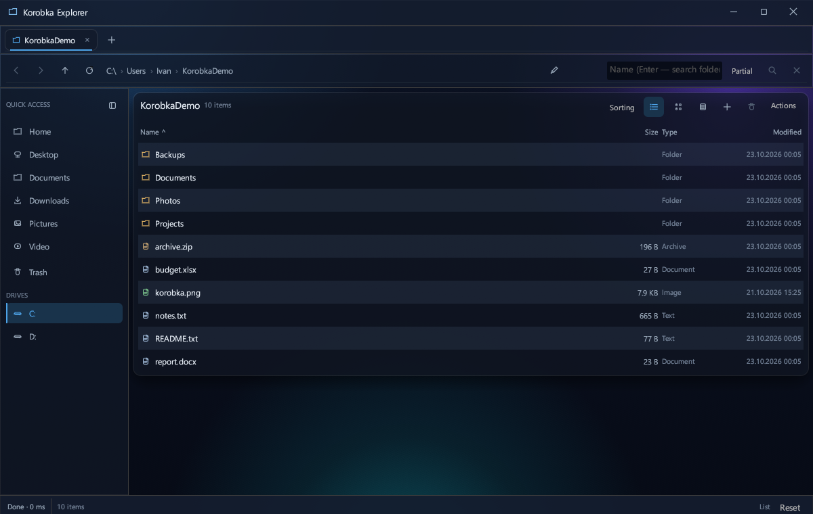
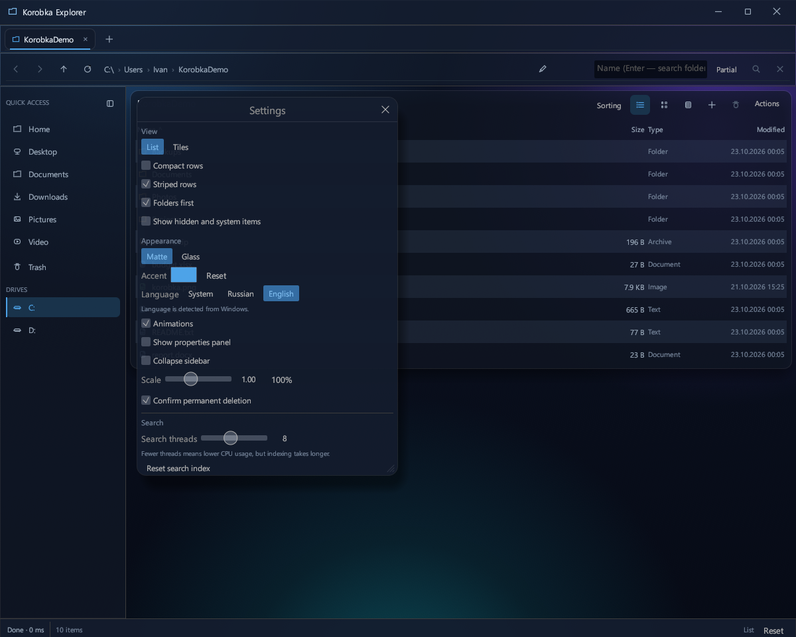
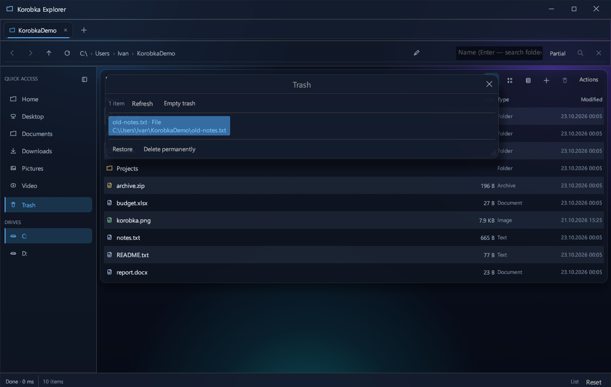

# Korobka Explorer

**A native Windows file manager written in Rust + egui.** Custom UI, fast indexed search, matte/glass themes, a restoreable trash, and long-path support.

[](https://github.com/ivangameapps-lab/korobka-explorer-public/releases/latest)
[](LICENSE)
[](#requirements)
[](https://www.rust-lang.org/)

[Русская версия](README.ru.md)

<p align="center">
  
</p>

## Overview

Korobka Explorer is not a skin over Windows Explorer. It is a standalone desktop application built with **Rust**, **eframe/egui 0.31** and **egui_extras**. It talks to Win32 directly for file enumeration, long paths, drives and process locks.

The project is intentionally small and native:

- single `~5 MB` executable, no runtime installer;
- no Python, Node.js, Electron or WebView;
- no telemetry, no background service, no network calls;
- settings and indexes live in `%LOCALAPPDATA%\Korobka`.

## Features

### Interface

- **Matte** — dense blue gradient; **Glass** — transparent panels over Windows acrylic.
- Accent color picker, transparency slider, optional background blur, animations and smooth 80–135% scaling.
- Custom title bar with drag, minimize, maximize and close.
- Tabs, clickable breadcrumbs, manual path editing, quick access and drives.
- Virtualized list and tile views: only visible rows are built.
- Properties panel: type, size, modified date and path.
- Explorer-style context menus, including **Create** (folder, text, Word, Excel, ZIP, empty file) and **Create shortcut** (`.lnk`).
- Status bar with operation progress, cancel, selection size and view mode.

### Search

- Typing filters the current folder **instantly** — no disk walk.
- `Enter` searches the current folder recursively; the magnifier searches the whole volume.
- **Exact name** and **part of name** modes.
- Multi-word queries, quoted phrases, `*`/`?` masks and path queries (`users\ivan\doc`).
- Ranking: exact name → prefix/word start → substring; shorter names first.
- Compact on-disk index: the directory path is stored once per block, entries only by name/type.
- Cache: `%LOCALAPPDATA%\Korobka\index`, per volume and per searched folder.
- Streaming cache reader; the legacy full-path index format is still accepted.
- Configurable index/search threads: **2–16**, default **8**.

### File operations

- Copy, move, paste, conflict handling (replace / keep both / skip / apply to all).
- Background progress and cancellation.
- `Del` moves to trash; `Shift+Del` deletes permanently (confirmation by default).
- **Trash window** in the sidebar: deleted items, original path, restore, selective delete and empty trash.
- `Ctrl+Z` undoes the last copy, move or trash operation.
- Restart Manager integration finds processes holding a file; soft close, force close, Explorer restart.
- Guards against copying a folder into itself; junctions/symlinks are not expanded.
- **Long paths**: absolute paths are sent to Win32 as `\\?\` / `\\?\UNC\`; the UI still shows normal paths.

### Languages and persistence

- Russian and English UI.
- Default is the **Windows system language**; Russian/English can be forced in settings.
- Settings are auto-saved 0.4 s after a change, when the settings window closes, and by the **Save settings** button.
- Session file: `%LOCALAPPDATA%\Korobka\session.json`, written atomically via a temporary file.

## Screenshots

| Main window | Settings |
|---|---|
|  |  |

| Trash |
|---|
|  |

## Requirements

> **This is a Rust project, not a Python project.** There is no `pip`, `venv`, `requirements.txt` or Python runtime involved. You need the Rust toolchain and the MSVC C++ build tools.

- Windows 10 or Windows 11, 64-bit
- Rust stable, MSVC toolchain
- Visual Studio Build Tools with **Desktop development with C++** and a Windows SDK
- Internet access for the first `cargo build` (crates.io)

### Install the Rust toolchain

```powershell
winget install --id Rustlang.Rustup -e
rustup default stable-x86_64-pc-windows-msvc
rustc --version
cargo --version
```

If you already have Rustup, make sure the MSVC toolchain is active:

```powershell
rustup show
rustup default stable-x86_64-pc-windows-msvc
```

### Install MSVC Build Tools

Install **Visual Studio 2022 Build Tools** and select the **Desktop development with C++** workload. The Windows 10/11 SDK is included by that workload.

```powershell
winget install --id Microsoft.VisualStudio.2022.BuildTools -e --override "--wait --passive --add Microsoft.VisualStudio.Workload.VCTools --includeRecommended"
```

Restart the terminal after installing the toolchain so that `cargo` and `link.exe` are on `PATH`.

## Build and run

```powershell
git clone https://github.com/ivangameapps-lab/korobka-explorer-public.git
cd korobka-explorer-public
cargo build --release
```

The binary is:

```text
target\release\korobka_explorer.exe
```

Run it:

```powershell
.\target\release\korobka_explorer.exe
```

Or open a folder immediately:

```powershell
.\target\release\korobka_explorer.exe "D:\Files"
```

For development:

```powershell
cargo run --release
cargo run --release -- "D:\Files"
```

A pre-built, unsigned executable is available in [Releases](https://github.com/ivangameapps-lab/korobka-explorer-public/releases/latest). Windows SmartScreen may warn because the binary is not code-signed.

## Usage

1. Launch the app; it reopens the last tabs from the session.
2. Type in the search box to filter the current folder instantly.
3. Press `Enter` to search the folder recursively, or click the magnifier to search the whole volume.
4. Use the **Actions** menu for operations, view settings and options.
5. Open **Settings** with `Ctrl+,` to switch language, theme, accent color, index threads and other options.
6. Click **Trash** in the sidebar to restore or permanently delete items.

## Keyboard shortcuts

| Action | Shortcut |
|---|---|
| New tab / close tab | `Ctrl+T` / `Ctrl+W` |
| Next / previous tab | `Ctrl+Tab` / `Ctrl+Shift+Tab` |
| Back / forward | `Alt+←` / `Alt+→` |
| Up | `Backspace` |
| Address bar | `Ctrl+L` |
| Search | `Ctrl+F` |
| Select all visible | `Ctrl+A` |
| Copy / cut / paste | `Ctrl+C` / `Ctrl+X` / `Ctrl+V` |
| Move to trash | `Del` |
| Delete permanently | `Shift+Del` |
| Rename | `F2` |
| Open | `Enter` |
| Refresh | `F5` |
| New folder | `Ctrl+Shift+N` |
| Undo | `Ctrl+Z` |
| Settings | `Ctrl+,` |

## Search details

- All words in a query must match. Quote a phrase to keep spaces: `"annual report 2026"`.
- `*.txt` and `report*` match the whole name; `rep?rt` matches any part.
- A term containing `\` or `/` is matched against the full path.
- The exact/partial mode applies both to the instant folder filter and to disk search.
- The first search after a file operation rebuilds the affected index; later searches read the cache.

## Performance

Measurements on a 16-logical-core Windows 11 machine, release build. Results depend on the disk and antivirus.

### Index build

User profile, **888,216 entries**:

| Threads | Run 1 | Run 2 | Run 3 |
|---:|---:|---:|---:|
| 4 | 1.739 s | 1.689 s | 1.765 s |
| **8 (default)** | 1.045 s | 1.013 s | 0.957 s |
| 12 | 0.924 s | 0.818 s | 0.814 s |
| 16 | 0.956 s | 0.809 s | 1.057 s |

16 threads do not help further — the build becomes disk/write bound.

### Cached search

Volume `C:\`, **2,250,276 entries**, six runs:

| Run | Time | From cache |
|---|---:|---|
| 1 | 0.131 s | yes |
| 2 | 0.124 s | yes |
| 3 | 0.124 s | yes |
| 4 | 0.132 s | yes |
| 5 | 0.135 s | yes |
| 6 | 0.123 s | yes |

### Resources and disk

| Item | Value |
|---|---:|
| `korobka_explorer.exe` | **5.09 MB** |
| Idle RAM | **80.3 MB working / 84.4 MB private** |
| Idle CPU | **0.00%** |
| Idle threads | 26 |
| `C:\` index | **90.16 MB** for 2.25M entries |
| Trash | 0.25 MB |
| `target/` after build | ~6.78 GB (build artifacts, not in the repo) |

> **Why does CPU spike during search?** The index is invalidated after file operations, and the first search rebuilds it. Reading an existing cache is ~0.13 s and uses almost no CPU. Reduce **Settings → Search → Search threads** to lower the rebuild ceiling.

## Architecture

| File | Responsibility |
|---|---|
| `src/main.rs` | Application, UI, tabs, settings, trash, operations |
| `src/search.rs` | Query engine, compact index, parallel walk, cache |
| `src/fs_ops.rs` | Copy, move, trash, delete, conflicts |
| `src/locks.rs` | Locking-process detection and Restart Manager |
| `src/archive.rs` | ZIP browsing and extraction |
| `src/drives.rs` | Drive enumeration and volume metadata |
| `src/path_util.rs` | Long-path `\\?\` helpers and display paths |
| `src/i18n.rs` | Russian/English UI strings |
| `src/shell_clipboard.rs` | File clipboard exchange with Explorer via CF_HDROP |

Stack: Rust 2021, eframe/egui 0.31, egui_extras, rayon, memchr, zip, serde, windows-sys.

## Testing

```powershell
cargo test
cargo clippy --all-targets
```

- **23 tests pass, 2 are ignored** (a lock test that spawns a helper and a Windows shortcut test).
- The suite was run three times in a row with the same result.
- Clippy reports no warnings.
- Covered: file/folder copy, move with replacement, trash, permanent delete, trash restore, index build/cache, legacy cache format, and search/copy/delete of paths longer than 260 characters.

## Nuances and limitations

- **Windows only.** Linux/macOS are not supported; several modules are Windows-specific.
- **Not the Windows Recycle Bin.** The trash is internal: `%LOCALAPPDATA%\Korobka\trash`. Restore from the app's Trash window; there is no Explorer integration.
- **Long paths** work inside the app, but opening a file in a third-party program may still depend on that program.
- **No installer and no code signing.** Build from source or use the unsigned release. SmartScreen may warn.
- **No incremental index yet.** After copy/delete/rename the index is marked stale and the next search rebuilds it. This is the one-time CPU spike.
- **No single-instance guard.** Running two instances may race on the session/index files.
- **No preview/thumbnails yet.**
- First build downloads crates and can take several minutes; `target/` grows to several GB during development.
- Settings and indexes are written under `%LOCALAPPDATA%\Korobka`; the executable itself is portable.

## Roadmap

- Incremental index updates instead of full rebuilds.
- `$MFT` / USN journal index for near-instant volume search.
- Single-instance protection.
- Windows Recycle Bin integration.
- File preview and thumbnails.
- GitHub Actions CI, installer and code signing.

## License

MIT — see [LICENSE](LICENSE).
