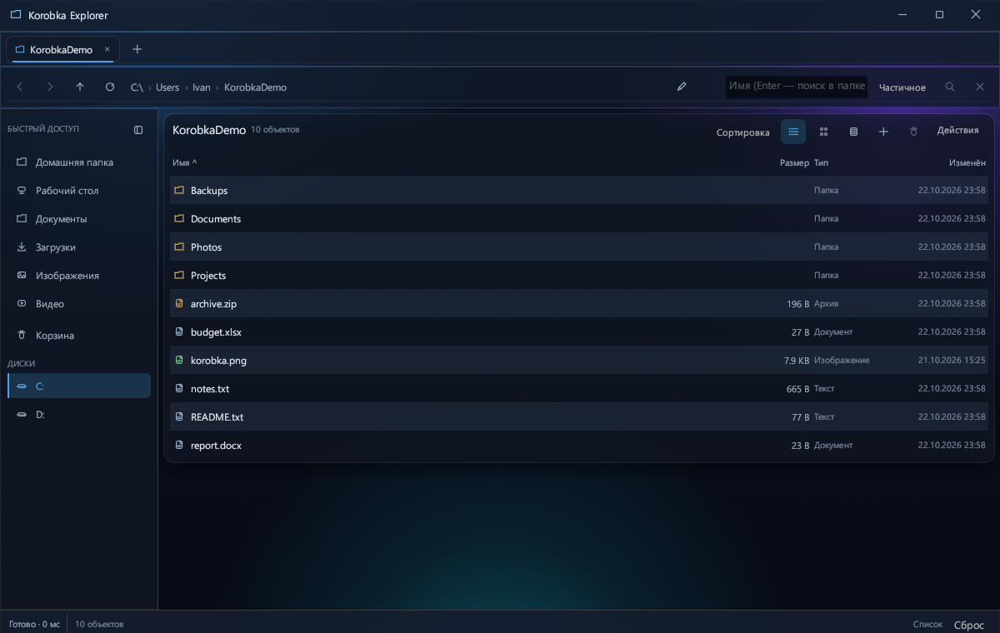
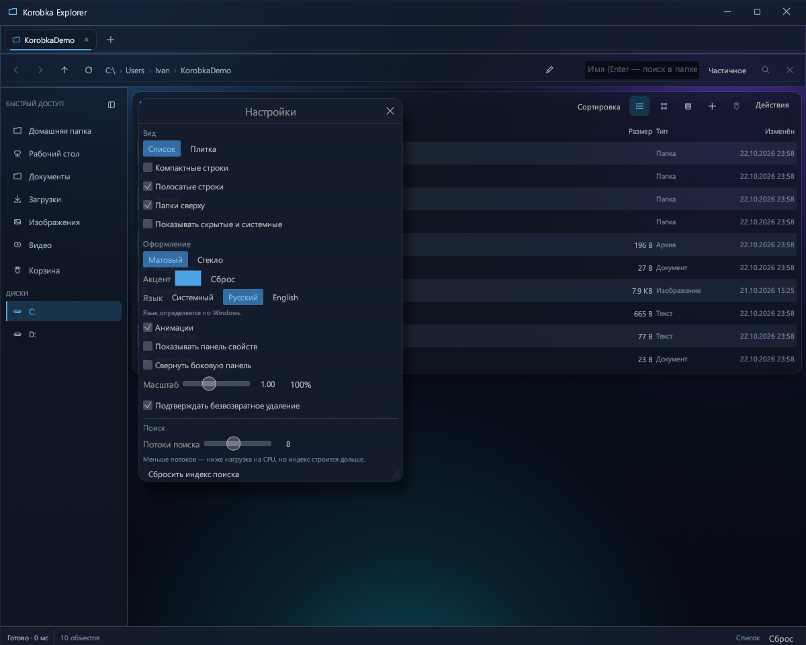
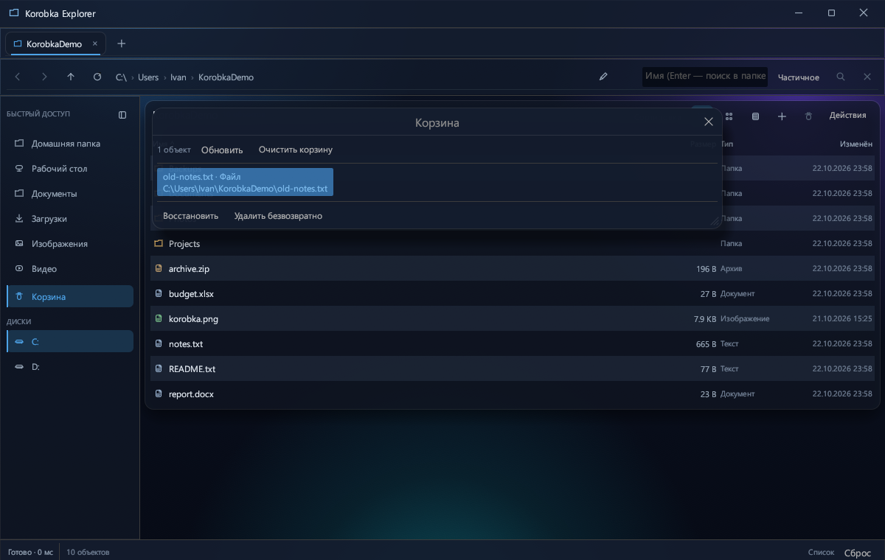

[English](README.md) · **Русский**

# Korobka Explorer

**Файловый менеджер для Windows на Rust + egui.** Собственный интерфейс, быстрый поиск по индексу, двухрежимное оформление, корзина с восстановлением и поддержка длинных путей.

<p align="center">
  
</p>

## Возможности

### Интерфейс

- Два оформления: **«Матовый»** — плотный синий градиент, и **«Стекло»** — прозрачные панели поверх акрила Windows.
- Настраиваемый акцентный цвет, ползунок прозрачности, отключаемое размытие фона, анимации и плавный масштаб 80–135%.
- Собственная шапка с перетаскиванием, сворачиванием, разворачиванием и закрытием.
- Вкладки, кликабельные хлебные крошки, ручной ввод пути, быстрый доступ и диски.
- Виртуализированный список и плитка: рисуются только видимые строки.
- Панель свойств: тип, размер, дата изменения, путь.
- Контекстные меню как в Проводнике: открыть, открыть в новой вкладке, копировать, вырезать, вставить, переименовать, свойства, удалить, создать ярлык.
- Правый клик по пустому месту: **«Создать»** (папка, текстовый документ, Word, Excel, ZIP, пустой файл), вставить, обновить, сортировка.
- Статусная строка: состояние, количество объектов, выделение и его размер, прогресс операции с отменой.

### Поиск

- Ввод в поле поиска **мгновенно фильтрует** текущую папку — без обхода диска.
- `Enter` — поиск по текущей папке и подпапкам, кнопка с лупой — по всему тому.
- Режимы **«Точное имя»** и **«По части имени»**.
- Запрос из нескольких слов: все слова должны совпасть. Фразу можно взять в кавычки.
- Маски `*` и `?`: `*.txt`, `отч?т`.
- Поиск по полному пути: `users\ivan\doc`.
- Ранжирование: точное имя → совпадение с начала имени/слова → вхождение; внутри группы короче — выше.
- Компактный индекс: полный путь папки хранится один раз на блок, элементы — только именами и типом.
- Кэш индекса: `%LOCALAPPDATA%\Korobka\index`. Отдельно для тома и для папок.
- Кэш читается потоково; старый формат индекса тоже читается без переобхода.
- Число потоков поиска настраивается: **2–16**, по умолчанию **8**.

### Файловые операции

- Копирование, перемещение, вставка, конфликтные ситуации: заменить, оставить оба, пропустить, применить ко всем.
- Прогресс и отмена в фоновом потоке.
- `Del` — в корзину, `Shift+Del` — безвозвратно (с подтверждением).
- **Корзина** в боковой панели: список удалённых объектов, исходный путь, восстановление, выборочное удаление и полная очистка.
- `Ctrl+Z` — отмена последнего копирования, перемещения или удаления в корзину.
- Поиск блокирующих процессов через Restart Manager, мягкое/принудительное закрытие, перезапуск Проводника.
- Защита от копирования папки внутрь самой себя; junction/symlink не разворачиваются при удалении и копировании.
- **Длинные пути**: для Win32-вызовов автоматически используется `\\?\` / `\\?\UNC\`; в интерфейсе путь показывается без префикса.

### Язык и настройки

- Русский и английский интерфейс.
- По умолчанию — **системный язык Windows**; можно принудительно выбрать «Русский» или «English».
- Настройки сохраняются автоматически через 0,4 с после изменения, при закрытии окна и по кнопке «Сохранить настройки».
- Файл сессии: `%LOCALAPPDATA%\Korobka\session.json`, запись атомарная (через временный файл).

## Скриншоты

| Главное окно | Настройки |
|---|---|
|  |  |

| Корзина |
|---|
|  |

## Быстрый старт

### Требования

- Windows 10/11
- Rust stable (MSVC toolchain)
- Visual Studio Build Tools с компонентом «Desktop development with C++»

### Сборка и запуск

```powershell
git clone https://github.com/ivangameapps-lab/korobka-explorer-public.git
cd korobka-explorer-public
cargo run --release
```

Готовый файл:

```text
target\release\korobka_explorer.exe
```

Готовую сборку также можно скачать в [Releases](https://github.com/ivangameapps-lab/korobka-explorer-public/releases/latest). Файл не подписан, поэтому Windows SmartScreen может показать предупреждение.

Можно открыть папку сразу:

```powershell
.\target\release\korobka_explorer.exe "D:\Files"
```

### Проверка

```powershell
cargo test
cargo clippy --all-targets
```

## Горячие клавиши

| Действие | Клавиши |
|---|---|
| Новая вкладка / закрыть вкладку | `Ctrl+T` / `Ctrl+W` |
| Переключение вкладок | `Ctrl+Tab` / `Ctrl+Shift+Tab` |
| Назад / вперёд | `Alt+←` / `Alt+→` |
| Вверх | `Backspace` |
| Адресная строка | `Ctrl+L` |
| Поиск | `Ctrl+F` |
| Выбрать всё видимое | `Ctrl+A` |
| Копировать / вырезать / вставить | `Ctrl+C` / `Ctrl+X` / `Ctrl+V` |
| Удалить в корзину | `Del` |
| Удалить безвозвратно | `Shift+Del` |
| Переименовать | `F2` |
| Открыть | `Enter` |
| Обновить | `F5` |
| Новая папка | `Ctrl+Shift+N` |
| Отменить операцию | `Ctrl+Z` |
| Настройки | `Ctrl+,` |

## Производительность

Замеры на 16 логических ядрах, release-сборка, Windows 11. Значения могут зависеть от диска и антивируса.

### Построение индекса

Профиль пользователя, **888 216 объектов**:

| Потоков | Прогон 1 | Прогон 2 | Прогон 3 |
|---:|---:|---:|---:|
| 4 | 1,739 с | 1,689 с | 1,765 с |
| **8 (по умолчанию)** | 1,045 с | 1,013 с | 0,957 с |
| 12 | 0,924 с | 0,818 с | 0,814 с |
| 16 | 0,956 с | 0,809 с | 1,057 с |

16 потоков уже не дают выигрыша — упирается в диск и запись кэша.

### Чтение готового кэша

Том `C:\`, **2 250 276 объектов**, 6 прогонов:

| Прогон | Время | Из кэша |
|---|---:|---|
| 1 | 0,131 с | да |
| 2 | 0,124 с | да |
| 3 | 0,124 с | да |
| 4 | 0,132 с | да |
| 5 | 0,135 с | да |
| 6 | 0,123 с | да |

### Ресурсы

| Параметр | Значение |
|---|---:|
| `korobka_explorer.exe` | **5,09 МБ** |
| RAM в простое | **80,3 МБ working / 84,4 МБ private** |
| CPU в простое | **0,00%** |
| Потоков в простое | 26 |
| Индекс тома `C:\` | **90,16 МБ** на 2,25 млн объектов |
| Корзина | 0,25 МБ |
| `target` после сборки | ~6,78 ГБ (артефакты, не входит в репозиторий) |

**Почему бывает высокая загрузка CPU?** Индекс помечается устаревшим после файловых операций, и первый следующий поиск перестраивает его. Это разовая нагрузка. При чтении готового кэша загрузка почти нулевая. Число потоков можно уменьшить в **Настройки → Поиск → Потоки поиска**.

## Устройство проекта

| Файл | Назначение |
|---|---|
| `src/main.rs` | Приложение, интерфейс, вкладки, настройки, корзина, операции |
| `src/search.rs` | Движок поиска, индекс, компактный кэш, параллельный обход |
| `src/fs_ops.rs` | Копирование, перемещение, корзина, удаление, конфликты |
| `src/locks.rs` | Поиск блокирующих процессов, Restart Manager |
| `src/archive.rs` | Просмотр и распаковка ZIP |
| `src/drives.rs` | Список дисков и метаданные томов |
| `src/path_util.rs` | Длинные пути `\\?\` и отображение |
| `src/i18n.rs` | Русский/английский интерфейс |
| `src/shell_clipboard.rs` | Обмен файлами с Проводником через CF_HDROP |

Стек: Rust 2021, eframe/egui 0.31, egui_extras, rayon, memchr, zip, serde, windows-sys.

## Тесты

- **23 теста проходят, 2 игнорируются** (lock-тест с дочерним процессом и создание ярлыка).
- Тесты запускались три раза подряд — стабильно.
- `cargo clippy --all-targets` — без предупреждений.
- Проверены: копирование файлов и папок, перемещение с заменой, корзина, безвозвратное удаление, восстановление из корзины, поиск/копирование/удаление путей длиннее 260 символов, компактный кэш и чтение старого формата.

## Ограничения

- Это **не** замена Проводнику и **не** интеграция с корзиной Windows: корзина своя, в `%LOCALAPPDATA%\Korobka\trash`. Восстановление — через окно корзины; отдельного окна Проводника нет.
- Длинные пути поддерживаются внутри приложения; открытие файла сторонней программой может зависеть от неё.
- Нет установщика и подписи кода — сборка из исходников.
- После файловых операций индекс перестраивается; инкрементального обновления пока нет.
- Нет preview/миниатюр и single-instance защиты.
- Приложение ориентировано на Windows.

## Планы

- Инкрементальное обновление индекса вместо полной перестройки.
- Индекс по `$MFT`/USN journal для мгновенного поиска.
- Единый экземпляр приложения.
- Интеграция с корзиной Windows.
- Preview и миниатюры.
- CI (GitHub Actions), установщик и подпись.

## Лицензия

MIT. См. [LICENSE](LICENSE).
